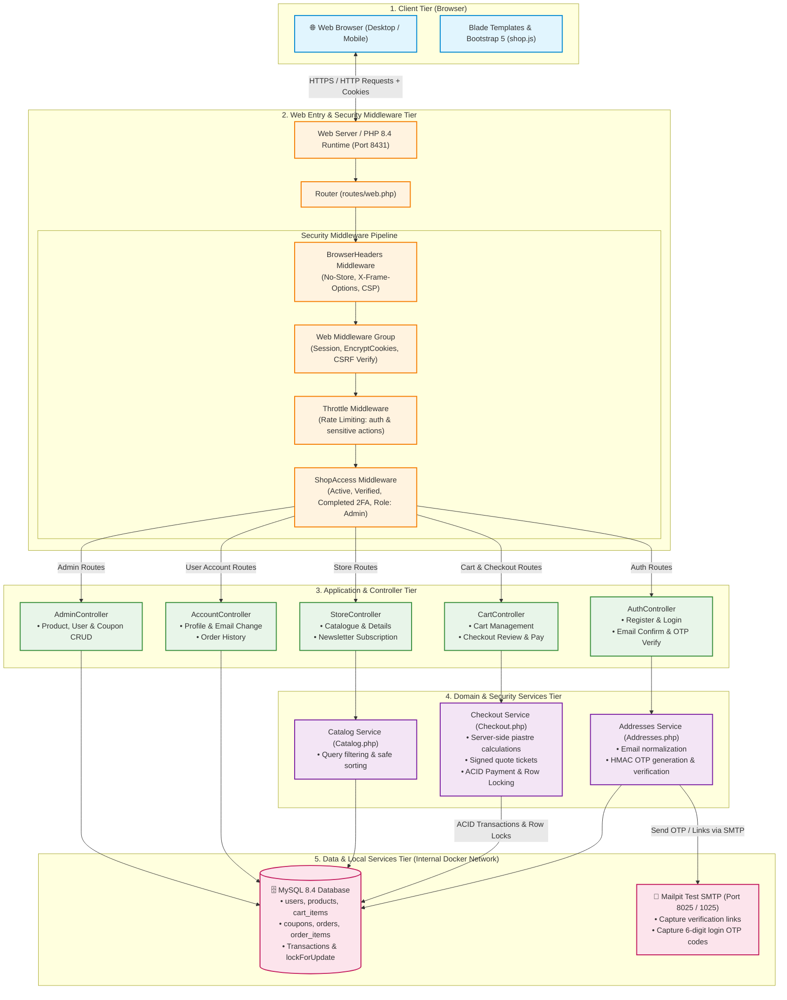
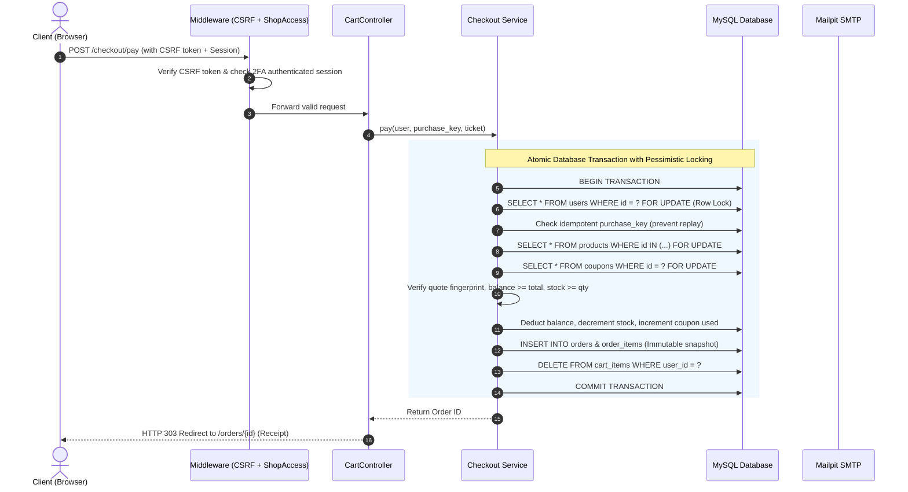

# SecureShop — System Architecture & Design

SecureShop is a security-hardened e-commerce prototype built with **Laravel 12**, **PHP 8.4**, **MySQL 8.4**, **Blade**, **Bootstrap 5**, and **Mailpit**, running entirely containerized via **Docker Compose**.

---

## 1. System Architecture Diagram

---

## 2. Request & Security Lifecycle (End-to-End Sequence)

The diagram below details the path of a sensitive user request (e.g., checkout & payment with concurrency protection):

---

## 3. Component Responsibilities

| Path / Component | Core Responsibility | Security Capabilities |
| :--- | :--- | :--- |
| `routes/web.php` | Routing definition for public, guest, authenticated and admin routes | Explicit route grouping, middleware attachment, parameter constraints (`whereNumber`) |
| `app/Http/Middleware/BrowserHeaders.php` | HTTP response headers | `Cache-Control: no-store`, `X-Content-Type-Options: nosniff`, `X-Frame-Options: DENY` |
| `app/Http/Middleware/ShopAccess.php` | Authentication and authorization gate | Requires active account status, verified email, completed OTP factor, and admin role checks |
| `app/Http/Controllers/AuthController.php` | Registration, login, confirmation, and OTP verification | Password hashing (Bcrypt/Argon2), HMAC token verification, login cooldown throttles |
| `app/Services/Addresses.php` | Email normalization & token lifecycle | Normalizes emails, hashes one-time tokens, constant-time hash comparisons |
| `app/Services/Checkout.php` | Pricing, checkout quotes, payment transaction | Server-side integer-piastre arithmetic, cryptographically signed quote tickets, row locking (`FOR UPDATE`) |
| `app/Http/Controllers/StoreController.php` | Public store catalogue & newsletter | Input allowlisting for sorting, safe parameterized Eloquent queries |
| `app/Http/Controllers/CartController.php` | Shopping cart and orders | Session-scoped cart queries (prevents IDOR), Post/Redirect/Get pattern |
| `app/Http/Controllers/AdminController.php` | Administrative management panel | Role-restricted management of products, users, and coupons |
| `database/migrations/` | Relational database schema | Strict Foreign Key constraints, composite unique indexes, cascades |
| `resources/views/` | Blade templates | Automatic output escaping `{{ $var }}` (XSS prevention), CSRF directive `@csrf` |

---

## 4. Key Security Architectural Mechanisms

### 4.1 Authentication & Multi-Factor (Email OTP)
1. **Password Verification:** Passwords must meet minimum complexity (>= 12 characters) and are verified using constant-time hash checks.
2. **Email OTP Factor:** Upon successful password verification, an unauthenticated session challenge is created with a 60-second lifetime. A random 6-digit code is generated; only its HMAC hash is stored in the database.
3. **Throttling & Cooldown:** 5 failed code attempts lock the factor for 5 minutes.
4. **Session Regeneration:** Upon completing the second factor, the session ID is regenerated to prevent session fixation attacks.

### 4.2 Financial Integrity & Concurrency Control
1. **Integer Piastre Storage:** All monetary values are represented as integers (piastres) avoiding floating-point rounding inaccuracies.
2. **Server-Side Pricing:** The client cannot submit totals. All totals are derived dynamically on the server from locked database records.
3. **Pessimistic Concurrency (Row Locking):** When paying, the user record, cart items, products, and coupon are locked using `SELECT ... FOR UPDATE` within an isolated ACID transaction.
4. **Idempotent Purchase Keys:** Each checkout session issues a cryptographically random UUID `purchase_key`. Resubmitting the same key returns the existing order rather than charging the customer twice.

### 4.3 Containerized Isolation
1. **Docker Compose Network:** MySQL and Mailpit communicate over an isolated internal network.
2. **Loopback Binding:** Only port `8431` (Storefront) and port `8025` (Mailpit Web UI) are exposed to the host machine, strictly bound to loopback `127.0.0.1`.
