# SecureShop — Database Schema & Entity Relationship Diagram (ERD)

This document details the database schema and entity relationships for the **SecureShop** e-commerce application. The schema is implemented via Laravel migrations targeting **MySQL 8.4** (`InnoDB` engine) with strict relational constraints and security considerations.

---

## 1. Entity Relationship Diagram (ERD)

```mermaid
erDiagram
    USERS ||--o{ CART_ITEMS : "has in cart"
    PRODUCTS ||--o{ CART_ITEMS : "added to"
    
    USERS ||--o{ ORDERS : "places"
    ORDERS ||--|{ ORDER_ITEMS : "contains"
    PRODUCTS ||--o{ ORDER_ITEMS : "snapshotted into"
    
    COUPONS ||--o{ COUPON_REDEMPTIONS : "redeemed via"
    USERS ||--o{ COUPON_REDEMPTIONS : "redeems"
    ORDERS ||--o| COUPON_REDEMPTIONS : "associated with"

    USERS {
        unsigned_bigint id PK
        string name
        string email UK "Normalized unique email"
        string pending_email "Nullable pending address"
        string email_token_hash "SHA-256 confirmation hash"
        timestamp email_token_expires
        timestamp email_verified_at
        string password "Bcrypt / Argon2 hash"
        text totp_secret "Legacy column"
        unsigned_bigint last_totp_step
        unsigned_tinyint factor_failures
        timestamp factor_locked_until
        string role "customer or admin"
        boolean active "Account lock status"
        unsigned_bigint balance "Integer piastres (default 100000)"
        char login_otp_hash "HMAC of 6-digit email OTP"
        char login_otp_challenge_hash "HMAC of session challenge nonce"
        timestamp login_otp_expires "60-second lifetime"
        unsigned_tinyint login_otp_failures "Failed code attempts counter"
        timestamp login_otp_locked_until "5-minute cooldown timestamp"
        timestamp created_at
        timestamp updated_at
    }

    PRODUCTS {
        unsigned_bigint id PK
        string name UK "Unique product name"
        string category "Indexed category filter"
        string description "Max 600 chars"
        string image "Relative asset path"
        unsigned_int price "Integer piastres (e.g. 50000 = 500 EGP)"
        unsigned_int stock "Inventory count"
        boolean active "Active / inactive toggle"
    }

    CART_ITEMS {
        unsigned_bigint user_id PK,FK "References users(id)"
        unsigned_bigint product_id PK,FK "References products(id)"
        unsigned_int quantity "Validated positive quantity"
    }

    COUPONS {
        unsigned_bigint id PK
        string code UK "Alphanumeric coupon code"
        string subscriber_email UK "Bound subscriber email"
        unsigned_tinyint percent "Discount percentage (1-100)"
        timestamp expires_at
        unsigned_int max_uses "Global ceiling"
        unsigned_int used "Usage counter"
        boolean active "Active toggle"
    }

    ORDERS {
        unsigned_bigint id PK
        unsigned_bigint user_id FK "References users(id)"
        uuid purchase_key "Idempotency key UK(user_id, purchase_key)"
        unsigned_bigint subtotal "Integer piastres"
        unsigned_bigint discount "Integer piastres"
        unsigned_bigint total "Integer piastres"
        unsigned_bigint balance_after "Customer balance snapshot"
        string coupon_code "Applied code snapshot"
        timestamp created_at
    }

    ORDER_ITEMS {
        unsigned_bigint id PK
        unsigned_bigint order_id FK "References orders(id)"
        unsigned_bigint product_id FK "References products(id)"
        string name "Snapshot of product name at purchase"
        unsigned_int price "Snapshot of unit price in piastres"
        unsigned_int quantity "Purchased quantity"
    }

    COUPON_REDEMPTIONS {
        unsigned_bigint coupon_id PK,FK "References coupons(id)"
        unsigned_bigint user_id PK,FK "References users(id)"
        unsigned_bigint order_id UK,FK "References orders(id)"
    }

    SEED_RUNS {
        string name PK "Seeder run tracking"
    }
```

---

## 2. Table Specifications & Relationships

### 2.1 `users`
* **Purpose:** Stores customer and administrator identities, authentication credentials, security token hashes, and wallet balance.
* **Key Constraints:**
  * `email` is `UNIQUE` to prevent account duplication.
  * `balance` is stored as an integer (`unsignedBigInteger`) representing Egyptian piastres (1 EGP = 100 piastres) to prevent floating-point calculation errors. Default is 100,000 piastres (1,000 EGP).
* **Security Attributes:**
  * Raw OTP codes and email verification tokens are **never** stored in plain text. Only cryptographic hashes (`login_otp_hash`, `email_token_hash`) are persisted.
  * Rate-limiting counters (`login_otp_failures`, `factor_failures`) and lock timestamps (`login_otp_locked_until`) are tracked per user.

### 2.2 `products`
* **Purpose:** Stores the catalogue inventory.
* **Key Constraints:**
  * `name` is `UNIQUE`.
  * `category` is indexed for efficient, safe filtering.
  * `price` and `stock` are unsigned integers.

### 2.3 `cart_items`
* **Purpose:** Persistent shopping cart tied strictly to the authenticated user.
* **Relationships:**
  * `user_id` $\rightarrow$ `users(id)` (Foreign Key with Cascade).
  * `product_id` $\rightarrow$ `products(id)` (Foreign Key with Cascade).
  * Composite Primary Key: `(user_id, product_id)` ensures a user has at most one record per product, updated by quantity.

### 2.4 `coupons` & `coupon_redemptions`
* **Purpose:** Manages discount vouchers and enforces one-time redemption rules.
* **Key Constraints:**
  * `code` is `UNIQUE`.
  * `subscriber_email` is `UNIQUE` and nullable; when set, only that verified email may redeem the coupon.
* **Redemption Security (`coupon_redemptions`):**
  * Composite Primary Key: `(coupon_id, user_id)` guarantees at the database level that **no user can ever redeem the same coupon more than once**, even in concurrent attack scenarios.
  * `order_id` is `UNIQUE` to link each redemption immutably to a single order.

### 2.5 `orders` & `order_items`
* **Purpose:** Immutable audit log and financial receipts.
* **Immutability by Design:**
  * `order_items` snapshots `name` and `price` at the instant of payment. If an administrator later changes a product's price or description, past receipts remain historically accurate.
  * `orders` contains a composite unique constraint on `(user_id, purchase_key)`. If a malicious client or network glitch replays a payment submission, MySQL rejects duplicate creation and returns the existing order.

---

## 3. Schema Security Safeguards

| Threat / Risk | Schema-Level Defense |
| :--- | :--- |
| **Race conditions & Double spending** | InnoDB row-level locking (`SELECT ... FOR UPDATE`) supported on `users`, `products`, `coupons`. |
| **Double coupon redemption** | Composite primary key `(coupon_id, user_id)` on `coupon_redemptions` enforces uniqueness at the database engine level. |
| **Payment replay attack** | Unique composite index on `orders(user_id, purchase_key)` prevents double charging. |
| **Precision & Rounding tampering** | Integer arithmetic for currency (`balance`, `price`, `subtotal`, `total`, `discount` in piastres). |
| **Credential disclosure via DB dump** | Passwords hashed using Bcrypt/Argon2; OTP codes hashed using HMAC with server secret; tokens hashed using SHA-256. |
| **Orphaned cart records** | Foreign key constraints (`ON DELETE CASCADE`) tied to `users` and `products`. |
