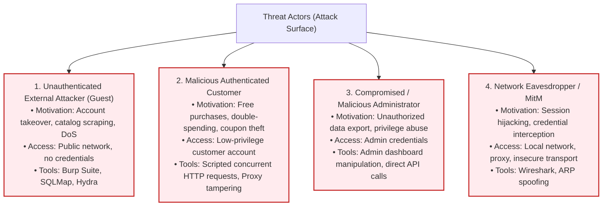
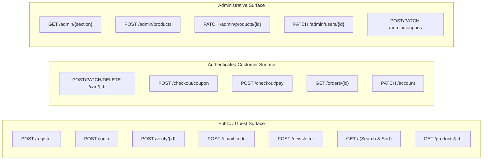

# SecureShop — Threat Model & Attack Surface Analysis

**Course:** CET431 – Software Security (Fall 2026)  
**Institution:** Elsewedy University of Technology - Polytechnic of Egypt  
**Project:** SecureShop E-Commerce System  
**Deliverable:** Security Design Report — Threat Model (Phase 1)

---

## 1. Executive Summary & Methodology

As required by the **CET431 Software Security** curriculum, every feature of SecureShop represents an element of the application's attack surface where an adversary can supply untrusted input or trigger server-side state transitions.

This threat model applies an **Asset-Centric** and **STRIDE** methodology (Spoofing, Tampering, Repudiation, Information Disclosure, Denial of Service, Elevation of Privilege) across all **8 Functional Features** of SecureShop. The objective is to identify potential threat actors, enumerate attack entry points, detail threat scenarios, and document the architectural and programmatic defenses implemented in the codebase.

---

## 2. Identification of Assets (الأصول المطلوب حمايتها)

Assets are the sensitive business, financial, and personal data items, as well as critical system states, that must be defended against compromise.

| Asset ID | Asset Name | Description & Location | Security Goals (CIA) | Business Impact of Compromise |
| :--- | :--- | :--- | :---: | :--- |
| **AST-01** | **User Wallet Balance** | Customer store credit stored in integer piastres in `users.balance`. | **Integrity** | Severe: Unauthorized balance inflation or theft results in direct financial loss. |
| **AST-02** | **Product Pricing & Stock** | Product catalog prices and real inventory numbers in `products.price` and `products.stock`. | **Integrity & Availability** | High: Price manipulation allows purchasing items below cost; stock tampering causes denial of inventory. |
| **AST-03** | **Discount Vouchers** | Promo codes, subscriber rules, and discount percentages in `coupons`. | **Integrity** | High: Unauthorized or repeated coupon applications deplete profit margins. |
| **AST-04** | **Authentication Credentials** | User passwords, password hashes, email OTP hashes, and session cookies. | **Confidentiality & Integrity** | Critical: Compromise leads to total account takeover and impersonation. |
| **AST-05** | **Customer Orders & Receipts** | Historical purchase records snapshot in `orders` and `order_items`. | **Confidentiality, Integrity, Non-Repudiation** | High: Unauthorized disclosure breaches privacy (IDOR); tampering undermines financial audit trails. |
| **AST-06** | **Administrative Privileges** | Admin role authorization gates governing product catalog, user status, and coupons. | **Integrity & Availability** | Critical: Unauthorized elevation grants full administrative control over the store. |
| **AST-07** | **Customer Personally Identifiable Info (PII)** | Real email addresses, names, pending emails in `users`. | **Confidentiality & Integrity** | Medium-High: Identity theft, unauthorized email modifications, spam targeting. |

---

## 3. Threat Actors / Attackers (تصنيف المهاجمين)

Adversaries are categorized according to their motivation, access level, and available tools:

1. **Unauthenticated External Attacker (Guest):** Seeks to exploit public-facing endpoints (Login, Register, Catalogue search, Newsletter). Attempts brute force, credential stuffing, SQL injection, and path traversal to gain unauthorized access.
2. **Malicious Authenticated Customer:** Possesses valid customer credentials. Attempts horizontal privilege escalation (IDOR on carts/receipts), business logic manipulation (submitting negative cart quantities or altered totals), and concurrency race conditions (double spending).
3. **Compromised / Malicious Administrator:** Attempts vertical privilege escalation or unauthorized alterations to customer balances, product prices, and system logs.
4. **Network Eavesdropper (MitM):** Operates on the local or transit network attempting to intercept session cookies, email verification links, or OTP challenges.

---

## 4. Entry Points & Attack Surface (حصر نقاط الدخول)

Every interaction channel where untrusted data enters the server represents an entry point:

| Entry Point ID | Route & HTTP Method | Target Feature | Input Parameters | Potential Threats |
| :--- | :--- | :--- | :--- | :--- |
| **EP-01** | `POST /register` | 1. Registration & Login | `name`, `email`, `password`, `password_confirmation` | Mass assignment (setting role or balance), SQLi, weak passwords |
| **EP-02** | `POST /login` | 1. Registration & Login | `email`, `password` | Credential stuffing, brute-force password guessing |
| **EP-03** | `GET/POST /verify/{id}` | 1. Registration & Login | `id`, URL fragment `#token`, hidden token input | Token prediction, token replay, confirmation bypass |
| **EP-04** | `POST /email-code` | 1. Registration & Login | `code` (6 digits) | OTP brute-force, challenge session desynchronization |
| **EP-05** | `POST /newsletter` | 4. Coupons & Newsletter | `email` | Denial of service, coupon generation abuse, email injection |
| **EP-06** | `GET /` | 2. Product Catalogue | `q` (search string), `sort`, `category` | SQL injection in queries, reflected XSS, order-by tampering |
| **EP-07** | `GET /products/{id}` | 2. Product Catalogue | `id` route parameter | SQL injection, unhandled type exceptions |
| **EP-08** | `POST/PATCH/DELETE /cart/{id}` | 3. Shopping Cart | `id`, `quantity` | Negative quantity values, integer overflow, cart hijacking |
| **EP-09** | `POST /checkout/coupon` | 4. Coupons & Newsletter | `code` | Coupon brute-forcing, applying expired/ineligible discounts |
| **EP-10** | `POST /checkout/pay` | 5. Checkout & Orders | `ticket`, `purchase_key`, `_token` | Client-side price tampering, double-spend race condition |
| **EP-11** | `GET /orders/{id}` | 5. Checkout & Orders | `id` route parameter | Insecure Direct Object Reference (IDOR) to view others' receipts |
| **EP-12** | `PATCH /account` | 6. User Account Page | `name`, `email` | Activating unverified email, mass assignment, CSRF |
| **EP-13** | `GET /admin/{section}` | 7. Admin Panel | `section` route param | Broken object level authorization, unauthorized data viewing |
| **EP-14** | `POST/PATCH /admin/products` | 7. Admin Panel | `name`, `category`, `price`, `stock`, `description` | Stored XSS in description, negative pricing, stock exhaustion |
| **EP-15** | `PATCH /admin/users/{id}` | 7. Admin Panel | `id`, `role`, `active` | Privilege escalation, self-admin lockout |

---

## 5. STRIDE Threat Analysis Across the 8 Features

| STRIDE Category | Affected Features | Threat Scenario in SecureShop | Risk Level | Implemented Security Defense | Defense Location in Code |
| :--- | :--- | :--- | :---: | :--- | :--- |
| **Spoofing** | 1. Auth 6. Account | Attacker guesses a 6-digit OTP code or submits someone else's email to log in. | **Critical** | • 60-second OTP expiration • Rate limiting (5 attempts $\rightarrow$ 5 min lock) • HMAC hash storage | `AuthController.php` `Addresses.php` |
| **Tampering** | 3. Cart 5. Checkout | Malicious customer intercepts checkout request and alters order total to 1 piastre. | **Critical** | • Server-side recalculation from locked DB rows • Signed quote ticket validation • Integer piastres arithmetic | `Checkout.php` `CartController.php` |
| **Repudiation** | 5. Checkout 7. Admin | Customer claims an order was executed twice by server mistake or disputes charge. | **Medium** | • Idempotent UUID `purchase_key` • Immutable `order_items` snapshots • Explicit `balance_after` record | `Checkout.php` `orders` table |
| **Information Disclosure** | 5. Checkout 6. Account | Customer increments receipt ID `/orders/1`, `/orders/2` to view other users' purchases. | **High** | • Query scoping: `Order::where('user_id', auth()->id())->findOrFail($id)` • HTTP 404 on mismatched owner | `CartController.php` `receipt()` method |
| **Denial of Service** | 1. Auth 4. Newsletter | Automated bot submits infinite registration, login, or newsletter requests. | **High** | • Route throttlers (`throttle:identity`, `throttle:factor`) • Normalized unique email constraints | `routes/web.php` `AppServiceProvider.php` |
| **Elevation of Privilege** | 1. Auth 7. Admin | Regular customer manually navigates to `/admin` or submits `role=admin` on register. | **Critical** | • `ShopAccess:admin` middleware check • Explicit `$fillable` allowlisting on `User` model • Database default `role='customer'` | `ShopAccess.php` `User.php` |

---

## 6. Deep-Dive Threat Scenarios & Implemented Defenses

### Threat Scenario 1: Client-Side Price & Subtotal Tampering (Lab 1)
* **Attack Mechanism:** An attacker uses a proxy (Burp Suite) or browser developer tools to alter the `total` or `discount` parameter sent in the checkout payload.
* **Root Cause:** Trusting client-submitted financial amounts without server-side verification.
* **Defense Architecture:** SecureShop completely ignores client-submitted price data. The `Checkout::pay()` service reads the current items from the `cart_items` table, fetches canonical unit prices directly from the `products` table, calculates integer piastre totals, and verifies eligibility before initiating payment.

### Threat Scenario 2: Double Spending via Concurrent Race Conditions (Lab 2)
* **Attack Mechanism:** An attacker with 1,000 EGP credit adds an item worth 1,000 EGP to their cart and submits two simultaneous `POST /checkout/pay` requests concurrently through automated multi-threaded scripts.
* **Root Cause:** Time-of-check to time-of-use (TOCTOU) gap between balance validation and debiting.
* **Defense Architecture:**
  1. Transaction Isolation: Payment runs inside a strict database transaction (`DB::transaction`).
  2. Pessimistic Row Locking: The user record is locked immediately via `User::lockForUpdate()->find($id)`.
  3. Subsequent parallel requests are blocked waiting for the first transaction to complete. When the second transaction acquires the lock, it reads the updated balance (0 EGP) and aborts with an insufficient credit exception.

### Threat Scenario 3: Coupon Replay & Expiry Circumvention (Lab 2)
* **Attack Mechanism:** A user tries to apply the `WELCOME10` coupon code across multiple tabs or accounts simultaneously, or reuse a one-time newsletter promo code.
* **Root Cause:** Lack of atomic redemption tracking and missing ownership checks.
* **Defense Architecture:**
  1. Relational Constraint: Table `coupon_redemptions` has a composite primary key `(coupon_id, user_id)`. MySQL rejects any second redemption attempt at the engine level.
  2. Newsletter Ownership: Newsletter coupons bind `subscriber_email` to the code; checkout requires the authenticated user's confirmed email to match before granting the discount.
  3. Global Cap: Coupons enforce `used < max_uses` inside row locks.

### Threat Scenario 4: Authentication Bypass & OTP Code Guessing (Lab 3)
* **Attack Mechanism:** An attacker submits valid user credentials, intercepts the OTP prompt, and rapidly brute-forces all $10^6$ combinations (000000–999999).
* **Root Cause:** Unlimited attempts, long OTP lifetimes, and plaintext storage.
* **Defense Architecture:**
  1. Expiry Window: Codes expire after 60 seconds.
  2. Exponential Penalty / Cooldown: 5 consecutive failed code submissions trigger a 5-minute lockout on the account.
  3. Cryptographic Storage: Codes are stored as HMAC-SHA256 hashes computed with the application secret key; raw codes are never persisted in the database.
  4. Constant-Time Comparison: Hash verification utilizes `hash_equals()` to thwart timing attacks.

### Threat Scenario 5: Cross-Site Request Forgery (CSRF) on Critical Actions
* **Attack Mechanism:** An attacker lures an authenticated customer to visit a malicious third-party site containing an auto-submitting form targeting `POST /checkout/pay` or `PATCH /account`.
* **Root Cause:** Browser automatically attaching session cookies without validating user intent.
* **Defense Architecture:**
  1. Laravel's web middleware group enforces encrypted session-bound CSRF tokens on all state-changing HTTP verbs (`POST`, `PATCH`, `DELETE`).
  2. Form submissions without valid `_token` parameters fail immediately with `HTTP 419 Page Expired`.
  3. SameSite cookie attributes (`SameSite=Lax`) prevent cross-site execution.

---

## 7. Residual Risks & Next Steps (Phase 2 Roadmap)

1. **Labs 4 & 5 Enhancements (Planned for Phase 2):**
   * Incorporating behavioral typing dynamics and WebAuthn/Passkey authentication for administrative accounts (as detailed in [admin-login-labs.md](admin-login-labs.md)).
2. **Red Team Penetration Testing Execution:**
   * Red Team members (Youssef Hamada & Hassan Ashraf) will execute automated and manual attack suites using Burp Suite and custom Python concurrency scripts to produce the formal *Attack Evidence Report*.
